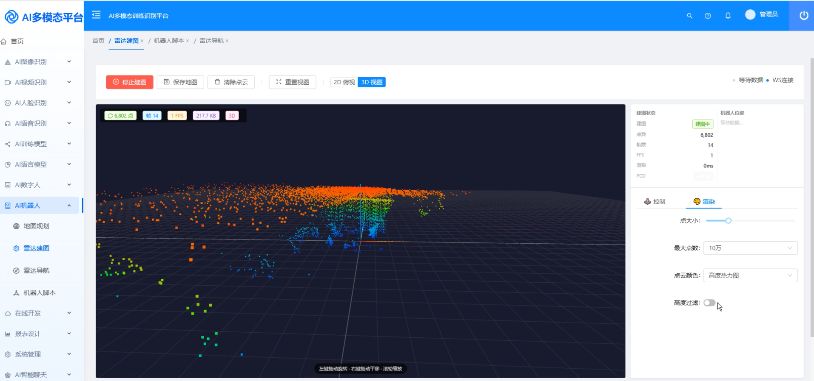
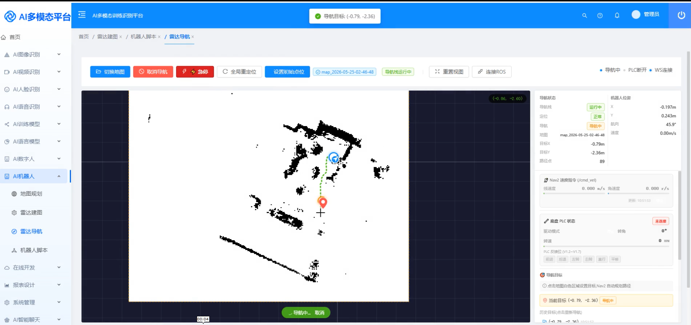
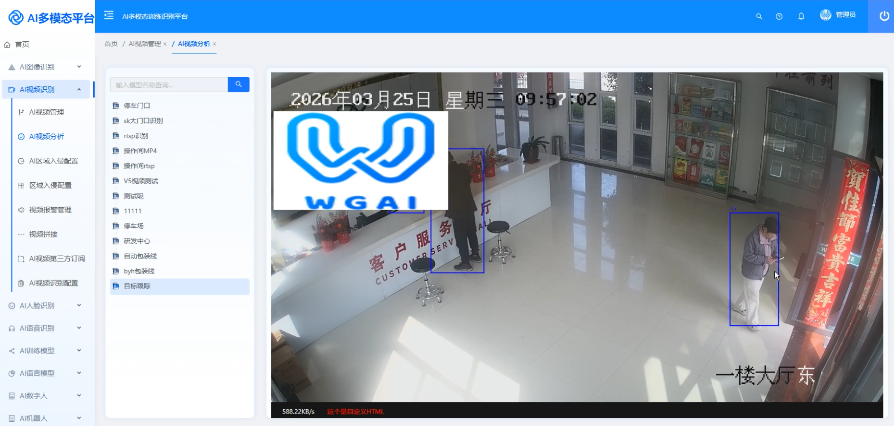
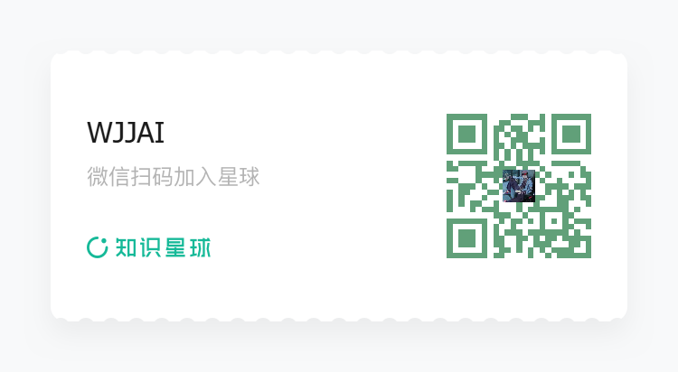

# 🚀 WGAI v5.3 发布：扫描地图 + 自主规划路线自动避障 + 跟踪识别物品

WGAI 迎来了新一轮版本升级。

本次版本 **WGAI v5.3** 重点围绕 **机器人自主导航能力 + AI视觉目标跟踪能力** 进行全面升级，让平台从“视觉识别”进一步迈向“机器人自主行动”。

本次升级重点包括：

- 新增 AVG雷达地图扫描
- 新增 自主路径规划导航
- 新增 动态自动避障
- 新增 人员/移动物体跟踪识别
- 优化 AGV导航能力
- 优化 AI视觉识别能力
- 提升机器人自主巡检能力

持续让 WGAI 成为 **AI视觉 + 智能机器人巡检平台**

---

# 🔥 核心升级一：AVG雷达地图扫描

在本次版本中，WGAI 已正式支持 **AVG激光雷达地图扫描能力**。

机器人可通过激光雷达实时进行：

- 环境扫描
- 地图构建
- 实时定位
- 地图可视化
- 地图保存

支持快速构建机器人工作环境地图。

实现：

> 扫描一次即可生成巡检环境地图

为机器人后续自主导航提供基础能力。

---

## 📷 地图扫描界面

---

## 🎥 演示视频

👉 [wgai-AVG雷达地图扫描](https://www.bilibili.com/video/BV1syGW6CEY1)

---

# ⚡ 核心升级二：自主规划导航 + 自动避障

本次版本进一步升级机器人自主导航能力。

系统基于地图可实现：

- 自动规划路线
- 多点导航
- 实时路径计算
- 动态障碍物避让
- 自动重规划路径

机器人在运行过程中遇到动态目标时：

- 自动识别障碍物
- 自动绕行
- 自动重新计算路线
- 保持任务持续执行

实现真正意义上的：

> 🚗 地图 → 自动规划 → 自动避障 → 自动到达

进一步提升机器人无人化巡检能力。

---

## 📷 路径规划界面

---

## 🎥 演示视频

👉 [wgai 路径自动规划导航](https://www.bilibili.com/video/BV1xyGW6CEMD)

---

# 🧠 核心升级三：人员 / 移动物体跟踪识别

WGAI 已支持 **目标跟踪识别能力**

可对：

- 人员
- 车辆
- 移动物体
- 指定目标

进行实时检测与持续跟踪。

系统支持：

- 实时目标识别
- ID目标跟踪
- 多目标识别
- 持续跟踪
- 自动锁定目标

在机器人巡检场景中，可实现：

- 自动跟随人员
- 自动识别移动目标
- 巡逻异常跟踪
- 指定目标持续跟踪

进一步增强 AI视觉与机器人联动能力。

---

## 📷 人员目标跟踪界面

---

## 🎥 演示视频

👉 [wgai 人员-移动物体跟踪识别](https://www.bilibili.com/video/BV11yGW6CEKj)

---

# 🤖 AGV导航能力升级

本次版本进一步完善机器人导航能力：

支持：

- 地图管理
- 路径规划
- 自动巡航
- 多点任务
- 动态避障
- 导航状态查看

开发者可以快速配置机器人巡检任务。

实现机器人自主执行：

- 巡检
- 导航
- 识别
- 跟踪

进一步降低开发门槛。

---

# 🎯 AI视觉能力优化

WGAI 支持多种视觉识别方式：

- 图片识别
- 视频识别
- 实时监控识别
- GPU实时推理
- 实时目标跟踪

本次版本进一步优化：

- 跟踪稳定性
- 推理性能
- GPU效率
- 模型加载速度
- 多目标识别能力

整体 AI视觉能力进一步提升。

---

# 🏭 应用场景

WGAI 可应用于多种场景：

- 🏭 工业巡检
- 📦 智慧仓储
- 🏗 安全巡检
- 🛡 视频监控
- 🤖 AGV机器人
- 🚗 自动巡检机器人

帮助企业快速落地：

**AI视觉 + 自主机器人能力**

---

# 🚀 下一版本预告

下一版本 WGAI 将重点升级：

**机器人自主决策 + AI大模型能力**

实现：

- 大模型任务理解
- 自然语言控制机器人
- AI任务规划
- 多机器人协同
- 自动巡检任务编排

未来实现：

> 🤖 让机器人真正具备自主思考能力

打造更完整的：

**AI视觉 + 大模型 + 智能机器人平台**

---

# ⭐ 项目地址

WGAI 已在 **Gitee 与 GitHub 开源**，欢迎体验与参与。

---

## 💬 **加入我们**

* 🧠 想了解更多模型训练技巧？
* 📚 想获得专属识别案例与源码？
* 欢迎加入 **WGAI 知识星球**
* 一起探索更高效、更智能的 AI 世界！

---

* **开源地址 Gitee**  
  <https://gitee.com/dromara/wgai>

* **开源地址 GitHub**  
  <https://github.com/dromara/wgai>

* **开源地址 GitCode**  
  <https://gitcode.com/dromara/wgai>

* **体验地址**  
  <http://1.95.152.91:9999/>

账号：wgai  
密码：wgai@2024

* **演示视频**  
  <https://www.bilibili.com/video/BV13C9BYiEFS?t=38.4>

* **加入社群**  
  

---

> 🔄 持续更新 · 专注本地化AI · 不被第三方卡脖子 · 永久开源